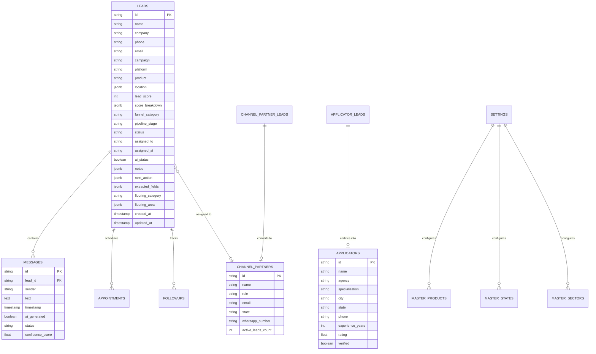

# ColourPlus B2B Industrial Flooring CRM - Backend API Specification & Contract

This document provides the complete, authoritative REST API specification required to connect the **ColourPlus Lead Desk Frontend** to a live backend (FastAPI / Express / Django / Go / NestJS) and database (PostgreSQL / MySQL / MongoDB).

---

## Table of Contents
1. [Architecture & Protocol Standards](#1-architecture--protocol-standards)
2. [Database ERD & Schema](#2-database-erd--schema)
3. [Master Endpoint Quick Reference](#3-master-endpoint-quick-reference)
4. [Detailed Endpoint Specifications](#4-detailed-endpoint-specifications)
   - [Section 1: System Health & Authentication](#section-1-system-health--authentication)
   - [Section 2: Dashboard KPIs & Analytics](#section-2-dashboard-kpis--analytics)
   - [Section 3: Leads Management](#section-3-leads-management)
   - [Section 4: WhatsApp Messaging & Webhooks](#section-4-whatsapp-messaging--webhooks)
   - [Section 5: Site Visits & Appointments](#section-5-site-visits--appointments)
   - [Section 6: Follow-up Tasks](#section-6-follow-up-tasks)
   - [Section 7: CRM Settings & Master Data](#section-7-crm-settings--master-data)
   - [Section 8: Channel Partners & Inbound Leads](#section-8-channel-partners--inbound-leads)
   - [Section 9: Certified Applicators & Inbound Leads](#section-9-certified-applicators--inbound-leads)
5. [Recommended PostgreSQL DDL Schema](#5-recommended-postgresql-ddl-schema)
6. [Meta WhatsApp Cloud API Webhook Integration](#6-meta-whatsapp-cloud-api-webhook-integration)
7. [Frontend Connection Instructions](#7-frontend-connection-instructions)

---

## 1. Architecture & Protocol Standards

- **Base URL**: `http://localhost:8000/api` (Development) / `https://api.colourplus.com/api` (Production)
- **Data Exchange Format**: `application/json; charset=utf-8`
- **Authentication**: `Authorization: Bearer <JWT_ACCESS_TOKEN>`
- **CORS Configuration**:
  ```http
  Access-Control-Allow-Origin: http://localhost:5173, https://desk.colourplus.com
  Access-Control-Allow-Methods: GET, POST, PUT, PATCH, DELETE, OPTIONS
  Access-Control-Allow-Headers: Content-Type, Authorization, X-Requested-With
  ```

### Standard Response Envelope (Recommended)
All successful endpoints may return data directly or wrapped in this standard envelope:
```json
{
  "success": true,
  "data": { ... },
  "message": "Operation completed successfully",
  "timestamp": "2026-10-19T11:40:00Z"
}
```

### Standard Error Response Format
```json
{
  "success": false,
  "error": {
    "code": "LEAD_NOT_FOUND",
    "message": "No lead exists with the specified ID: lead-101",
    "details": null
  },
  "timestamp": "2026-10-19T11:40:00Z"
}
```

---

## 2. Database ERD & Schema



---

## 3. Master Endpoint Quick Reference

| Method | Endpoint Path | Description | Frontend Consumer |
|---|---|---|---|
| `GET` | `/api/health` | Health check & DB connection status | System |
| `GET` | `/api/kpis` | Real-time KPI counters & funnel stats | `KpiStrip.tsx`, `Header.tsx` |
| `GET` | `/api/analytics/campaigns` | Campaign ROI & channel metrics | `AnalyticsView.tsx` |
| `GET` | `/api/leads` | Paginated/filtered lead list | `LeadInbox.tsx` |
| `GET` | `/api/leads/{id}` | Single lead full details | `LeadDetailView.tsx` |
| `PUT` | `/api/leads/{id}` | Full lead update | `LeadDetailView.tsx` |
| `POST` | `/api/leads/{id}/assign` | Assign single lead to partner/rep | `AssignLeadModal.tsx` |
| `POST` | `/api/leads/bulk-assign` | Batch assign multiple leads | `BulkAssignModal.tsx` |
| `PATCH` | `/api/leads/{id}/stage` | Advance lead pipeline stage | `StageProgress.tsx` |
| `POST` | `/api/leads/{id}/notes` | Append sales note to lead | `AddNoteModal.tsx` |
| `PATCH` | `/api/leads/{id}/ai-status` | Toggle AI auto-pilot vs human mode | `ChatPanel.tsx` |
| `PATCH` | `/api/leads/{id}/score` | Update qualification score & breakdown | `ScorePanel.tsx` |
| `PATCH` | `/api/leads/{id}/flooring-category` | Update facility sector/sub-type | `FieldList.tsx` |
| `POST` | `/api/leads/{id}/extracted-fields` | Add AI extracted specification field | `FieldList.tsx` |
| `GET` | `/api/leads/{id}/messages` | Get WhatsApp chat transcript | `ChatPanel.tsx` |
| `POST` | `/api/leads/{id}/messages` | Send human or bot WhatsApp reply | `ChatPanel.tsx` |
| `POST` | `/api/webhooks/whatsapp` | Meta WhatsApp Cloud API inbound webhook | Webhook Listener |
| `GET` | `/api/appointments` | Get confirmed & pending site visits | `AppointmentsView.tsx` |
| `POST` | `/api/appointments` | Book new site visit appointment | `ConfirmVisitModal.tsx` |
| `PUT` | `/api/appointments/{id}` | Update appointment status/reschedule | `AppointmentsView.tsx` |
| `GET` | `/api/followups` | Get scheduled follow-up tasks | `FollowupsView.tsx` |
| `POST` | `/api/followups` | Schedule new follow-up task | `NextAction.tsx` |
| `PATCH` | `/api/followups/{id}/toggle-status`| Mark task pending / completed | `FollowupsView.tsx` |
| `GET` | `/api/settings` | Get CRM settings & master data | `SettingsView.tsx`, `App.tsx` |
| `PUT` | `/api/settings` | Save CRM settings & scoring cut-offs | `SettingsView.tsx` |
| `POST` | `/api/settings/reset-defaults` | Revert settings to factory defaults | `SettingsView.tsx` |
| `GET` | `/api/settings/products` | Get master product catalog | Filter dropdowns |
| `POST` | `/api/settings/products` | Add product to catalog | `SettingsView.tsx` |
| `DELETE`| `/api/settings/products/{name}` | Remove product from catalog | `SettingsView.tsx` |
| `GET` | `/api/settings/states` | Get territory coverage states | Filter dropdowns, Modals |
| `POST` | `/api/settings/states` | Add state to coverage | `SettingsView.tsx` |
| `DELETE`| `/api/settings/states/{name}` | Remove state from coverage | `SettingsView.tsx` |
| `GET` | `/api/settings/facility-sectors`| Get master facility sectors | Filter dropdowns |
| `POST` | `/api/settings/facility-sectors`| Add facility sector | `SettingsView.tsx` |
| `DELETE`| `/api/settings/facility-sectors/{name}`| Remove facility sector | `SettingsView.tsx` |
| `GET` | `/api/channel-partners` | List all active channel partners | `ChannelPartnersView.tsx` |
| `POST` | `/api/channel-partners` | Register new channel partner | `AddChannelPartnerModal.tsx` |
| `DELETE`| `/api/channel-partners/{id}` | Delete channel partner | `ChannelPartnersView.tsx` |
| `GET` | `/api/channel-partners/leads` | Inbound WhatsApp partner inquiries | `ChannelPartnersView.tsx` |
| `POST` | `/api/channel-partners/leads/{id}/approve` | Approve partner inquiry into network | `ChannelPartnersView.tsx` |
| `DELETE`| `/api/channel-partners/leads/{id}` | Dismiss partner lead inquiry | `ChannelPartnersView.tsx` |
| `GET` | `/api/applicators` | List certified applicators | `ApplicatorsView.tsx` |
| `POST` | `/api/applicators` | Register new applicator contractor | `AddApplicatorModal.tsx` |
| `DELETE`| `/api/applicators/{id}` | Delete applicator contractor | `ApplicatorsView.tsx` |
| `GET` | `/api/applicators/leads` | Inbound WhatsApp applicator inquiries | `ApplicatorsView.tsx` |
| `POST` | `/api/applicators/leads/{id}/approve` | Certify applicator inquiry | `ApplicatorsView.tsx` |
| `DELETE`| `/api/applicators/leads/{id}` | Dismiss applicator lead inquiry | `ApplicatorsView.tsx` |

---

## 4. Detailed Endpoint Specifications

### Section 1: System Health & Authentication

#### `GET /api/health`
- **Description**: Verifies API availability, database connection, and WhatsApp webhook listener.
- **Request Headers**: None required
- **Success Response (200 OK)**:
```json
{
  "status": "healthy",
  "database": "connected",
  "version": "1.0.0",
  "environment": "production",
  "timestamp": "2026-10-19T11:40:00Z"
}
```

---

### Section 2: Dashboard KPIs & Analytics

#### `GET /api/kpis`
- **Description**: Returns live aggregated counters displayed in the top KPI strip.
- **Query Parameters**: None
- **Success Response (200 OK)**:
```json
{
  "total_leads": 124,
  "new_leads_today": 18,
  "hot_leads": 42,
  "unanswered_over_20h": 3,
  "site_visits_confirmed": 28,
  "closed_leads": 19,
  "average_score": 78.4,
  "cost_per_lead": "₹142.50",
  "assigned_leads": 96
}
```

#### `GET /api/analytics/campaigns`
- **Description**: Returns multi-channel performance data for the Analytics View.
- **Success Response (200 OK)**:
```json
[
  {
    "campaign": "Epoxy Flooring Factory Owners KA",
    "platform": "Meta Ads",
    "total_leads": 64,
    "delivery_rate": 98.4,
    "read_rate": 84.2,
    "reply_rate": 61.5,
    "click_rate": 34.0,
    "hot_leads": 28,
    "warm_leads": 22,
    "nurture_leads": 10,
    "out_of_scope_leads": 4,
    "avg_score": 82.5,
    "conversion_rate": 28.5,
    "cost_per_lead": 135.0,
    "est_pipeline_value": 4850000,
    "recommendation": "SCALE_UP"
  }
]
```

---

### Section 3: Leads Management

#### `GET /api/leads`
- **Description**: Retrieves leads list with multi-dimensional filtering, searching, and sorting.
- **Query Parameters**:
  - `campaign` (string, optional): Filter by ad campaign name or `ALL`.
  - `product` (string, optional): Filter by product name or `ALL`.
  - `state` (string, optional): Filter by region/state name or `ALL`.
  - `sector` (string, optional): Filter by facility sector or `ALL`.
  - `funnel` (string, optional): `HOT` | `WARM` | `NURTURE` | `OUT_OF_SCOPE` | `ALL`.
  - `assigned_status` (string, optional): `ALL` | `UNASSIGNED` | `ASSIGNED` | `TODAY`.
  - `month` (string, optional): Format `YYYY-MM` (e.g. `2026-10`).
  - `date` (string, optional): Format `YYYY-MM-DD` (e.g. `2026-10-19`).
  - `search` (string, optional): Full-text query on name, company, city, notes.
- **Success Response (200 OK)**:
```json
[
  {
    "id": "cp-lead-101",
    "name": "Suresh Gowda",
    "company": "Apex Precision Engineering Ltd",
    "phone": "+91 98450 12345",
    "email": "suresh.gowda@apexeng.in",
    "campaign": "Epoxy Flooring Factory Owners KA",
    "platform": "WhatsApp Direct",
    "product": "Epoxy Floor Coating",
    "location": {
      "address": "Plot 42, Peenya Industrial Area 2nd Stage",
      "maps_link": "https://maps.google.com/?q=Peenya+Bangalore",
      "city": "Bengaluru",
      "state": "Karnataka",
      "area_sqft": 15000
    },
    "lead_score": 88,
    "score_breakdown": {
      "fit": 28,
      "opportunity": 22,
      "intent": 18,
      "urgency": 12,
      "completeness": 8
    },
    "funnel_category": "HOT",
    "pipeline_stage": "Qualified",
    "status": "Qualified",
    "assigned_to": "Rajesh Kumar (Bengaluru)",
    "assigned_at": "2026-10-19T09:15:00Z",
    "ai_status": true,
    "notes": [
      {
        "id": "note-1",
        "text": "Factory expansion ready by mid-November. Needs anti-skid 4mm epoxy.",
        "author": "Antigravity AI",
        "timestamp": "2026-10-19T08:35:00Z"
      }
    ],
    "next_action": {
      "title": "Site Visit Confirmed",
      "description": "Technical engineer visit scheduled for site survey.",
      "due_date": "Today, 02:30 PM",
      "type": "visit"
    },
    "extracted_fields": [
      {
        "key": "Floor Area Required",
        "value": "15,000 sq.ft",
        "confidence": 0.98,
        "is_verified": true
      },
      {
        "key": "Existing Substrate",
        "value": "M25 Grade PCC with micro-cracks",
        "confidence": 0.92,
        "is_verified": true
      }
    ],
    "flooring_category": "Factory & Industrial",
    "flooring_area": {
      "category": "Factory & Industrial",
      "sub_type": "CNC Machining & Heavy Assembly Bay"
    },
    "created_at": "2026-10-19T08:30:00Z",
    "updated_at": "2026-10-19T09:15:00Z",
    "last_activity": "2026-10-19T09:15:00Z"
  }
]
```

#### `GET /api/leads/{id}`
- **Description**: Returns a single lead by its unique identifier.
- **Success Response (200 OK)**: Returns the single `Lead` object above.
- **Error Response (404 Not Found)**:
```json
{
  "success": false,
  "error": { "code": "LEAD_NOT_FOUND", "message": "Lead with id cp-lead-999 not found" }
}
```

#### `POST /api/leads/{id}/assign`
- **Description**: Assigns a lead to an authorized Channel Partner or Technical Sales Representative. Sends automated WhatsApp dispatch alerts to the rep and confirmation to the client.
- **Request Body**:
```json
{
  "assignee": "Rajesh Kumar (Bengaluru)",
  "sendWhatsappAlert": true,
  "sendEmailAlert": true,
  "partner": {
    "id": "cp-1",
    "name": "Rajesh Kumar",
    "role": "Channel Partner (Bengaluru)",
    "email": "rajesh.kumar@colourpluspartners.com",
    "state": "Karnataka",
    "whatsapp_number": "+91 98450 11223"
  }
}
```
- **Success Response (200 OK)**: Returns updated `Lead` object.

#### `POST /api/leads/bulk-assign`
- **Description**: Assigns multiple selected leads to a single sales representative in one batch transaction.
- **Request Body**:
```json
{
  "lead_ids": ["cp-lead-101", "cp-lead-102", "cp-lead-105"],
  "assignee": "Vikram Sethi (Chennai)",
  "sendWhatsappAlert": true,
  "sendEmailAlert": false
}
```
- **Success Response (200 OK)**:
```json
{
  "success": true,
  "assigned_count": 3,
  "assignee": "Vikram Sethi (Chennai)"
}
```

#### `PATCH /api/leads/{id}/stage`
- **Description**: Advances or changes a lead's B2B pipeline stage.
- **Request Body**:
```json
{
  "stage": "Visit"
}
```
- **Allowed Values**: `"Lead"`, `"Qualified"`, `"Visit"`, `"Quote"`, `"Follow-up"`, `"Won"`
- **Success Response (200 OK)**: Returns updated `Lead` object.

#### `POST /api/leads/{id}/notes`
- **Description**: Appends an internal note or site survey remark to a lead's timeline.
- **Request Body**:
```json
{
  "text": "Client requested sample test patch for forklift abrasion resistance on bay 2."
}
```
- **Success Response (201 Created)**: Returns updated `Lead` object with new note appended.

#### `PATCH /api/leads/{id}/ai-status`
- **Description**: Toggles between AI Automated Qualification mode and Human Sales Takeover.
- **Request Body**:
```json
{
  "ai_active": false
}
```
- **Success Response (200 OK)**: Returns updated `Lead` object.

#### `PATCH /api/leads/{id}/score`
- **Description**: Updates lead qualification score and five-dimensional sub-scores.
- **Request Body**:
```json
{
  "lead_score": 92,
  "score_breakdown": {
    "fit": 30,
    "opportunity": 24,
    "intent": 18,
    "urgency": 12,
    "completeness": 8
  }
}
```

---

### Section 4: WhatsApp Messaging & Webhooks

#### `GET /api/leads/{id}/messages`
- **Description**: Fetches full WhatsApp chat conversation transcript for a lead.
- **Success Response (200 OK)**:
```json
[
  {
    "id": "msg-1",
    "lead_id": "cp-lead-101",
    "sender": "user",
    "text": "Hello, we need 15000 sqft epoxy coating for our Peenya factory.",
    "timestamp": "2026-10-19T08:30:00Z",
    "status": "read"
  },
  {
    "id": "msg-2",
    "lead_id": "cp-lead-101",
    "sender": "bot",
    "text": "Welcome to ColourPlus Polyurethanes! What is the current condition of your concrete floor?",
    "timestamp": "2026-10-19T08:31:00Z",
    "ai_generated": true,
    "status": "delivered",
    "confidence_score": 0.96
  }
]
```

#### `POST /api/leads/{id}/messages`
- **Description**: Sends an outbound WhatsApp message via Meta WhatsApp Business Cloud API.
- **Request Body**:
```json
{
  "text": "Our technical engineer Rajesh Kumar will arrive at your Peenya factory at 2:30 PM.",
  "sender": "human",
  "ai_generated": false
}
```
- **Success Response (201 Created)**: Returns the newly inserted `Message` object.

#### `POST /api/webhooks/whatsapp`
- **Description**: Inbound webhook receiver for Meta WhatsApp Cloud API events (messages, delivery status, read receipts).
- **Request Body (Meta Webhook Payload)**:
```json
{
  "object": "whatsapp_business_account",
  "entry": [
    {
      "id": "WHATSAPP_BUSINESS_ACCOUNT_ID",
      "changes": [
        {
          "value": {
            "messaging_product": "whatsapp",
            "metadata": { "display_phone_number": "15550269874", "phone_number_id": "10492837482" },
            "contacts": [{ "profile": { "name": "Suresh Gowda" }, "wa_id": "919845012345" }],
            "messages": [
              {
                "from": "919845012345",
                "id": "wamid.HBgLMjE...",
                "timestamp": "1792383742",
                "text": { "body": "Can you provide a quotation for heavy duty polyurethane?" },
                "type": "text"
              }
            ]
          },
          "field": "messages"
        }
      ]
    }
  ]
}
```
- **Success Response (200 OK)**: `"EVENT_RECEIVED"`

---

### Section 5: Site Visits & Appointments

#### `GET /api/appointments`
- **Description**: Retrieves all scheduled, completed, and pending site survey visits.
- **Success Response (200 OK)**:
```json
[
  {
    "id": "app-101",
    "lead_id": "cp-lead-101",
    "lead_name": "Suresh Gowda",
    "company": "Apex Precision Engineering Ltd",
    "date": "2026-10-19",
    "time": "02:30 PM",
    "location": "Plot 42, Peenya Industrial Area 2nd Stage, Bengaluru",
    "status": "confirmed",
    "engineer": "Rajesh Kumar (Senior Technical Consultant)",
    "notes": "Moisture meter test & surface hardness Schmidt hammer test required."
  }
]
```

#### `POST /api/appointments`
- **Description**: Books and confirms a new site visit appointment.
- **Request Body**:
```json
{
  "lead_id": "cp-lead-101",
  "lead_name": "Suresh Gowda",
  "company": "Apex Precision Engineering Ltd",
  "date": "2026-10-21",
  "time": "11:00 AM",
  "location": "Peenya 2nd Stage, Bengaluru",
  "engineer": "Rajesh Kumar",
  "notes": "Bring moisture meter and ColourPlus shade cards."
}
```
- **Success Response (201 Created)**: Returns the newly created `Appointment` object.

---

### Section 6: Follow-up Tasks

#### `GET /api/followups`
- **Description**: Retrieves pending and completed follow-up action items.
- **Success Response (200 OK)**:
```json
[
  {
    "id": "fol-1",
    "lead_id": "cp-lead-101",
    "lead_name": "Suresh Gowda",
    "company": "Apex Precision Engineering Ltd",
    "title": "Send Formal BoQ & Technical Datasheet",
    "description": "Send ColourPlus EPU 4mm specifications and client references.",
    "due_date": "2026-10-20",
    "status": "pending",
    "type": "quote"
  }
]
```

#### `PATCH /api/followups/{id}/toggle-status`
- **Description**: Toggles follow-up between `'pending'` and `'completed'`.
- **Success Response (200 OK)**: Returns updated `Followup` object.

---

### Section 7: CRM Settings & Master Data

#### `GET /api/settings`
- **Description**: Fetches current CRM configuration, qualification cut-offs, and master catalogs (products, states, facility sectors).
- **Success Response (200 OK)**:
```json
{
  "scoring_thresholds": {
    "hot_min": 75,
    "warm_min": 50,
    "nurture_min": 0
  },
  "supported_languages": ["English", "Kannada", "Hindi", "Kannada/English Mixed"],
  "ai_mode": "auto",
  "auto_assign_hot": true,
  "unreplied_warning_threshold_hours": 20,
  "products": [
    "Epoxy Floor Coating",
    "Epoxy Self-Leveling – Matt Finish",
    "Anti-Skid Coating Flooring",
    "ESD Coating Flooring",
    "High-Build Epoxy Mortar",
    "Epoxy Polyurethane (EPU) Coating",
    "Polyurethane Coating",
    "Dielectric Insulation Flooring",
    "Polycrete Flooring",
    "Wall Coating",
    "Waterproofing",
    "Anti-Corrosive Coating"
  ],
  "states": [
    "Karnataka",
    "Tamil Nadu",
    "Telangana",
    "Maharashtra",
    "Andhra Pradesh",
    "Kerala",
    "Gujarat",
    "Delhi NCR"
  ],
  "facility_sectors": [
    "Factory & Industrial",
    "Pharma & Cleanroom",
    "Warehouse & Logistics",
    "Commercial & Terrace",
    "Cold Storage & Food",
    "Household & Residential",
    "Automobile & Garages",
    "Other / General"
  ]
}
```

#### `PUT /api/settings`
- **Description**: Updates full CRM configuration and thresholds.
- **Request Body**: Entire `CRMSettings` JSON payload above.
- **Success Response (200 OK)**: Returns updated `CRMSettings`.

#### `POST /api/settings/products`
- **Description**: Adds a new product to the master catalog (which immediately populates filter dropdowns).
- **Request Body**:
```json
{
  "name": "Polyurea Fast-Cure Spray 500"
}
```
- **Success Response (201 Created)**: Returns the updated `string[]` array of products.

#### `DELETE /api/settings/products/{name}`
- **Description**: Deletes a product from the master catalog.
- **Success Response (200 OK)**: Returns the updated `string[]` array of products.

#### `POST /api/settings/states`
- **Description**: Adds a state/territory to regional coverage.
- **Request Body**:
```json
{
  "name": "Rajasthan"
}
```
- **Success Response (201 Created)**: Returns the updated `string[]` array of states.

#### `DELETE /api/settings/states/{name}`
- **Description**: Removes a state/territory from regional coverage.
- **Success Response (200 OK)**: Returns the updated `string[]` array of states.

#### `POST /api/settings/facility-sectors`
- **Description**: Adds a new industrial flooring facility sector.
- **Request Body**:
```json
{
  "name": "Semiconductor Cleanrooms"
}
```
- **Success Response (201 Created)**: Returns the updated `string[]` array of facility sectors.

#### `DELETE /api/settings/facility-sectors/{name}`
- **Description**: Removes a facility sector from configuration.
- **Success Response (200 OK)**: Returns the updated `string[]` array of facility sectors.

#### `POST /api/settings/reset-defaults`
- **Description**: Resets master products, states, and sectors back to initial ColourPlus factory standards.
- **Success Response (200 OK)**: Returns restored `CRMSettings`.

---

### Section 8: Channel Partners & Inbound Leads

#### `GET /api/channel-partners`
- **Description**: Returns all registered channel partners & sales reps.
- **Success Response (200 OK)**:
```json
[
  {
    "id": "cp-1",
    "name": "Rajesh Kumar",
    "role": "Channel Partner (Bengaluru)",
    "email": "rajesh.kumar@colourpluspartners.com",
    "state": "Karnataka",
    "whatsapp_number": "+91 98450 11223",
    "active_leads_count": 8
  }
]
```

#### `POST /api/channel-partners`
- **Description**: Adds a new authorized channel partner.
- **Request Body**:
```json
{
  "name": "Vikram Sethi",
  "role": "Territory Distributor",
  "email": "vikram.sethi@chennaicoatings.in",
  "state": "Tamil Nadu",
  "whatsapp_number": "+91 94440 55667"
}
```
- **Success Response (201 Created)**: Returns the newly registered `ChannelPartner` object.

#### `DELETE /api/channel-partners/{id}`
- **Description**: Deletes a channel partner from the network.
- **Success Response (200 OK)**: `{ "success": true, "deleted_id": "cp-1" }`

#### `GET /api/channel-partners/leads`
- **Description**: Fetches inbound partner inquiries received via WhatsApp ad campaigns.
- **Success Response (200 OK)**:
```json
[
  {
    "id": "cpl-101",
    "firm_name": "Shree Balaji Industrial Hardware",
    "contact_person": "Ramesh Patel",
    "whatsapp_number": "+91 98250 88991",
    "city": "Ahmedabad",
    "state": "Gujarat",
    "experience_years": 12,
    "current_turnover": "₹4.5 Cr / year",
    "current_brands": "Berger, Asian Paints Industrial",
    "commercial_warehouse": "5,000 sqft in Changodar",
    "lead_score": 92,
    "status": "New Inquiry",
    "created_at": "2026-10-18T10:15:00Z"
  }
]
```

#### `POST /api/channel-partners/leads/{id}/approve`
- **Description**: Approves an inbound partner inquiry, generating a registered `ChannelPartner` record and setting lead status to `"Approved"`.
- **Success Response (200 OK)**:
```json
{
  "partner": {
    "id": "cp-1792384910",
    "name": "Shree Balaji Industrial Hardware",
    "role": "Channel Partner (Ahmedabad)",
    "email": "ramesh@balajihardware.com",
    "state": "Gujarat",
    "whatsapp_number": "+91 98250 88991"
  },
  "lead": {
    "id": "cpl-101",
    "status": "Approved"
  }
}
```

---

### Section 9: Certified Applicators & Inbound Leads

#### `GET /api/applicators`
- **Description**: Returns all certified ColourPlus applicator contractors.
- **Success Response (200 OK)**:
```json
[
  {
    "id": "app-1",
    "name": "Arunachalam Murugan",
    "agency": "Precision Polymer Floorings",
    "specialization": "PU Concrete & Heavy Duty Epoxy",
    "city": "Bengaluru",
    "state": "Karnataka",
    "phone": "+91 98451 22334",
    "experienceYears": 11,
    "rating": 4.9,
    "verified": true,
    "activeProjects": 3,
    "completedProjects": 48
  }
]
```

#### `POST /api/applicators`
- **Description**: Registers a new certified applicator.
- **Request Body**:
```json
{
  "name": "Manoj Shinde",
  "agency": "Pune Epoxy Master",
  "specialization": "ESD Coating Flooring & Cleanroom Screed",
  "city": "Pune",
  "state": "Maharashtra",
  "phone": "+91 98220 33445",
  "experienceYears": 8
}
```
- **Success Response (201 Created)**: Returns the newly registered `Applicator` object.

#### `DELETE /api/applicators/{id}`
- **Description**: Removes an applicator from certification records.
- **Success Response (200 OK)**: `{ "success": true, "deleted_id": "app-1" }`

#### `GET /api/applicators/leads`
- **Description**: Fetches inbound applicator contractor inquiries from WhatsApp ad campaigns.
- **Success Response (200 OK)**:
```json
[
  {
    "id": "apl-101",
    "firm_name": "Sai Floor Tech Solutions",
    "master_contractor": "Kiran Kumar",
    "whatsapp_number": "+91 98480 33445",
    "city": "Hyderabad",
    "state": "Telangana",
    "experience_years": 9,
    "team_size": 18,
    "machinery_owned": "4x HTC Diamond Grinders, 2x Dust Extractors",
    "specialization": "Pharma Cleanroom & Anti-Static ESD",
    "lead_score": 90,
    "status": "New Inquiry",
    "created_at": "2026-10-18T14:20:00Z"
  }
]
```

#### `POST /api/applicators/leads/{id}/approve`
- **Description**: Approves an applicator inquiry, adding them to active Certified Applicators and updating status to `"Certified"`.
- **Success Response (200 OK)**:
```json
{
  "applicator": {
    "id": "app-1792384999",
    "name": "Sai Floor Tech Solutions",
    "agency": "Kiran Kumar (Hyderabad)",
    "specialization": "Pharma Cleanroom & Anti-Static ESD",
    "city": "Hyderabad",
    "state": "Telangana",
    "phone": "+91 98480 33445",
    "experienceYears": 9,
    "rating": 4.8,
    "verified": true
  },
  "lead": {
    "id": "apl-101",
    "status": "Certified"
  }
}
```

---

## 5. Recommended PostgreSQL DDL Schema

Backend engineers can run this initial schema migration on PostgreSQL or Supabase:

```sql
-- 1. EXTENSIONS
CREATE EXTENSION IF NOT EXISTS "uuid-ossp";

-- 2. MASTER DATA & SETTINGS
CREATE TABLE crm_settings (
    id VARCHAR(50) PRIMARY KEY DEFAULT 'default',
    scoring_thresholds JSONB NOT NULL DEFAULT '{"hot_min": 75, "warm_min": 50, "nurture_min": 0}',
    supported_languages JSONB NOT NULL DEFAULT '["English", "Kannada", "Hindi"]',
    ai_mode VARCHAR(20) NOT NULL DEFAULT 'auto',
    auto_assign_hot BOOLEAN NOT NULL DEFAULT true,
    unreplied_warning_threshold_hours INT NOT NULL DEFAULT 20,
    products JSONB NOT NULL,
    states JSONB NOT NULL,
    facility_sectors JSONB NOT NULL,
    updated_at TIMESTAMP WITH TIME ZONE DEFAULT NOW()
);

-- 3. CHANNEL PARTNERS
CREATE TABLE channel_partners (
    id VARCHAR(50) PRIMARY KEY,
    name VARCHAR(255) NOT NULL,
    role VARCHAR(255) NOT NULL,
    email VARCHAR(255),
    state VARCHAR(100) NOT NULL,
    whatsapp_number VARCHAR(50) NOT NULL,
    active_leads_count INT DEFAULT 0,
    created_at TIMESTAMP WITH TIME ZONE DEFAULT NOW()
);

-- 4. CHANNEL PARTNER LEADS (WHATSAPP ADS)
CREATE TABLE channel_partner_leads (
    id VARCHAR(50) PRIMARY KEY,
    firm_name VARCHAR(255) NOT NULL,
    contact_person VARCHAR(255),
    whatsapp_number VARCHAR(50) NOT NULL,
    city VARCHAR(100) NOT NULL,
    state VARCHAR(100) NOT NULL,
    experience_years INT DEFAULT 0,
    current_turnover VARCHAR(100),
    current_brands VARCHAR(255),
    commercial_warehouse VARCHAR(255),
    lead_score INT DEFAULT 50,
    status VARCHAR(50) NOT NULL DEFAULT 'New Inquiry',
    created_at TIMESTAMP WITH TIME ZONE DEFAULT NOW()
);

-- 5. APPLICATORS
CREATE TABLE applicators (
    id VARCHAR(50) PRIMARY KEY,
    name VARCHAR(255) NOT NULL,
    agency VARCHAR(255) NOT NULL,
    specialization VARCHAR(255) NOT NULL,
    city VARCHAR(100) NOT NULL,
    state VARCHAR(100) NOT NULL,
    phone VARCHAR(50) NOT NULL,
    experience_years INT DEFAULT 5,
    rating NUMERIC(2,1) DEFAULT 4.8,
    verified BOOLEAN DEFAULT true,
    created_at TIMESTAMP WITH TIME ZONE DEFAULT NOW()
);

-- 6. APPLICATOR LEADS (WHATSAPP ADS)
CREATE TABLE applicator_leads (
    id VARCHAR(50) PRIMARY KEY,
    firm_name VARCHAR(255) NOT NULL,
    master_contractor VARCHAR(255) NOT NULL,
    whatsapp_number VARCHAR(50) NOT NULL,
    city VARCHAR(100) NOT NULL,
    state VARCHAR(100) NOT NULL,
    experience_years INT DEFAULT 0,
    team_size INT DEFAULT 0,
    machinery_owned TEXT,
    specialization VARCHAR(255),
    lead_score INT DEFAULT 50,
    status VARCHAR(50) NOT NULL DEFAULT 'New Inquiry',
    created_at TIMESTAMP WITH TIME ZONE DEFAULT NOW()
);

-- 7. LEADS
CREATE TABLE leads (
    id VARCHAR(50) PRIMARY KEY,
    name VARCHAR(255) NOT NULL,
    company VARCHAR(255) NOT NULL,
    phone VARCHAR(50) NOT NULL,
    email VARCHAR(255),
    campaign VARCHAR(255),
    platform VARCHAR(50) DEFAULT 'WhatsApp Direct',
    product VARCHAR(255),
    location JSONB NOT NULL,
    lead_score INT DEFAULT 50,
    score_breakdown JSONB,
    funnel_category VARCHAR(50) NOT NULL DEFAULT 'WARM',
    pipeline_stage VARCHAR(50) NOT NULL DEFAULT 'Lead',
    status VARCHAR(50) NOT NULL DEFAULT 'New',
    assigned_to VARCHAR(255),
    assigned_at TIMESTAMP WITH TIME ZONE,
    ai_status BOOLEAN DEFAULT true,
    notes JSONB DEFAULT '[]',
    next_action JSONB,
    extracted_fields JSONB DEFAULT '[]',
    flooring_category VARCHAR(100),
    flooring_area JSONB,
    created_at TIMESTAMP WITH TIME ZONE DEFAULT NOW(),
    updated_at TIMESTAMP WITH TIME ZONE DEFAULT NOW(),
    last_activity TIMESTAMP WITH TIME ZONE DEFAULT NOW()
);

-- 8. MESSAGES
CREATE TABLE messages (
    id VARCHAR(50) PRIMARY KEY,
    lead_id VARCHAR(50) REFERENCES leads(id) ON DELETE CASCADE,
    sender VARCHAR(20) NOT NULL,
    text TEXT NOT NULL,
    timestamp TIMESTAMP WITH TIME ZONE DEFAULT NOW(),
    ai_generated BOOLEAN DEFAULT false,
    status VARCHAR(20) DEFAULT 'delivered',
    confidence_score NUMERIC(3,2)
);

-- 9. APPOINTMENTS (SITE VISITS)
CREATE TABLE appointments (
    id VARCHAR(50) PRIMARY KEY,
    lead_id VARCHAR(50) REFERENCES leads(id) ON DELETE CASCADE,
    lead_name VARCHAR(255) NOT NULL,
    company VARCHAR(255) NOT NULL,
    date DATE NOT NULL,
    time VARCHAR(50) NOT NULL,
    location TEXT NOT NULL,
    status VARCHAR(50) DEFAULT 'confirmed',
    engineer VARCHAR(255) NOT NULL,
    notes TEXT,
    created_at TIMESTAMP WITH TIME ZONE DEFAULT NOW()
);

-- 10. FOLLOWUPS
CREATE TABLE followups (
    id VARCHAR(50) PRIMARY KEY,
    lead_id VARCHAR(50) REFERENCES leads(id) ON DELETE CASCADE,
    lead_name VARCHAR(255) NOT NULL,
    company VARCHAR(255) NOT NULL,
    title VARCHAR(255) NOT NULL,
    description TEXT,
    due_date VARCHAR(50) NOT NULL,
    status VARCHAR(20) DEFAULT 'pending',
    type VARCHAR(50) DEFAULT 'call',
    created_at TIMESTAMP WITH TIME ZONE DEFAULT NOW()
);

-- INDEXES FOR HIGH-THROUGHPUT FILTERING
CREATE INDEX idx_leads_funnel ON leads(funnel_category);
CREATE INDEX idx_leads_stage ON leads(pipeline_stage);
CREATE INDEX idx_leads_product ON leads(product);
CREATE INDEX idx_leads_created ON leads(created_at);
CREATE INDEX idx_messages_lead ON messages(lead_id);
```

---

## 6. Meta WhatsApp Cloud API Webhook Integration

### 1. Webhook Verification (GET)
Meta will ping your webhook to verify the challenge token:
```python
# FastAPI Example
@app.get("/api/webhooks/whatsapp")
def verify_webhook(
    hub_mode: str = Query(None, alias="hub.mode"),
    hub_verify_token: str = Query(None, alias="hub.verify_token"),
    hub_challenge: str = Query(None, alias="hub.challenge")
):
    if hub_mode == "subscribe" and hub_verify_token == "COLOURPLUS_VERIFY_TOKEN":
        return int(hub_challenge)
    raise HTTPException(status_code=403, detail="Verification failed")
```

### 2. Inbound Message Processing (POST)
When a customer sends a message on WhatsApp:
1. Extract customer phone number `wa_id` and message `body`.
2. Look up or auto-create `Lead` in `leads` table.
3. Append message to `messages` table.
4. If `lead.ai_status == true`, run AI Prompt Engine (Gemini / Claude / OpenAI):
   - Extract specifications (sqft area, current floor substrate, chemical exposure).
   - Compute `ScoreBreakdown` & `lead_score`.
   - Send automated qualification reply back via WhatsApp Cloud API.
5. If `lead_score >= 75` and `settings.auto_assign_hot == true`, auto-assign to nearest state channel partner and notify rep via WhatsApp template.

---

## 7. Frontend Connection Instructions

### Step 1: Set the API Base URL
In the frontend folder, copy `.env.example` to `.env`:
```bash
cp .env.example .env
```
Set `VITE_API_BASE_URL` to your running backend:
```env
VITE_API_BASE_URL=http://localhost:8000/api
```

### Step 2: Transitioning `src/services/api.ts`
All frontend calls already go through `crmApi` methods in [src/services/api.ts](file:///c:/Users/Acer-Pc/Downloads/Frontend/src/services/api.ts).
To connect directly to the real backend, replace the local state return with `fetch`:

```typescript
// Example: Converting getLeads() in src/services/api.ts
import { API_ENDPOINTS } from './endpoints';

async getLeads(): Promise<Lead[]> {
  const response = await fetch(API_ENDPOINTS.LEADS);
  if (!response.ok) throw new Error('Failed to fetch leads');
  const data = await response.json();
  return data;
}
```

The contracts defined in [src/services/endpoints.ts](file:///c:/Users/Acer-Pc/Downloads/Frontend/src/services/endpoints.ts) and this document are already 100% matched with the React components.
